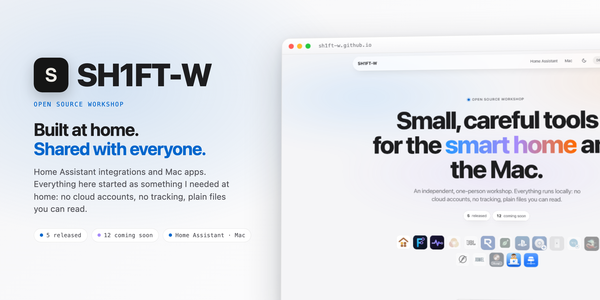
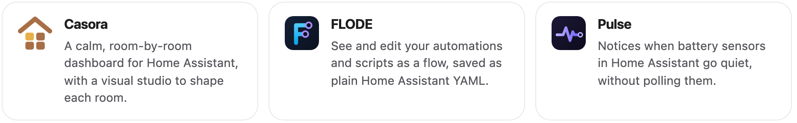
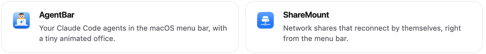

<picture>
  <source media="(prefers-color-scheme: dark)" srcset="docs/images/readme-title-dark.png" />
  
</picture>

I build Home Assistant integrations and dashboards, and small apps for the Mac menu bar. 
Everything here started as something I needed at home. It runs locally: no cloud accounts, no tracking, plain files you can read.

<a href="https://sh1ft-w.github.io"><b>Website</b></a> &nbsp;·&nbsp; <a href="#home-assistant">Home Assistant</a> &nbsp;·&nbsp; <a href="#mac">Mac</a> &nbsp;·&nbsp; <a href="#soon">Coming soon</a> &nbsp;·&nbsp; <a href="#how">How I work</a>

 

<b>HOME ASSISTANT</b>
## Three integrations you can install today.

<picture>
  <source media="(prefers-color-scheme: dark)" srcset="docs/images/readme-cards-ha-dark.png" />
  
</picture>

<a href="https://github.com/SH1FT-W/casora"><b>Casora</b></a> <a href="https://sh1ft-w.github.io/casora">website</a> &nbsp;·&nbsp; <a href="https://github.com/SH1FT-W/flode"><b>FLODE</b></a> <a href="https://sh1ft-w.github.io/flode">website</a> &nbsp;·&nbsp; <a href="https://github.com/SH1FT-W/pulse"><b>Pulse</b></a> <a href="https://sh1ft-w.github.io/pulse">website</a>

 

<b>MAC</b>
## Two apps for the menu bar.

<picture>
  <source media="(prefers-color-scheme: dark)" srcset="docs/images/readme-cards-mac-dark.png" />
  
</picture>

<a href="https://github.com/SH1FT-W/agentbar"><b>AgentBar</b></a> <a href="https://sh1ft-w.github.io/agentbar">website</a> &nbsp;·&nbsp; <a href="https://github.com/SH1FT-W/sharemount"><b>ShareMount</b></a> <a href="https://sh1ft-w.github.io/sharemount">website</a>

 

<b>COMING SOON</b>
## On the bench.

Integrations that already run at home and are being readied for release. They appear on the [website](https://sh1ft-w.github.io) first.

<picture>
  <source media="(prefers-color-scheme: dark)" srcset="docs/images/readme-cards-soon-dark.png" />
  
</picture>

 

<b>HOW I WORK</b>
## Local first. Plain files. Nothing phones home.

- **Local first.** Everything runs inside your Home Assistant or on your Mac. No account, no analytics, no telemetry.
- **Plain files.** Settings and data are readable files on your own machine, part of your own backups.
- **Built in the open.** Every project is on GitHub with a changelog and an issue tracker. Found a bug or have an idea? Open an issue in the project's repository.

 

  Everything in one place: <a href="https://sh1ft-w.github.io"><b>sh1ft-w.github.io</b></a> &nbsp;·&nbsp; Built with <a href="https://claude.ai">Claude</a>

