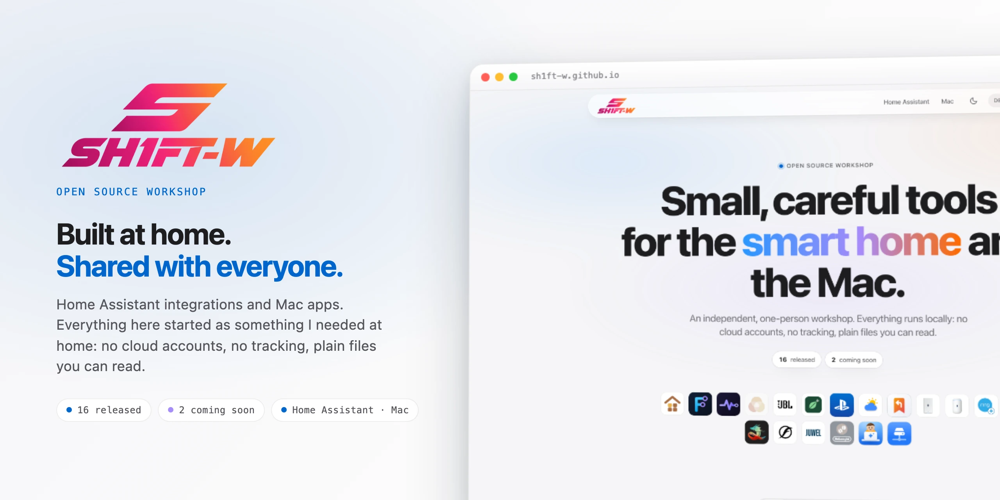

<picture>
  <source media="(prefers-color-scheme: dark)" srcset="docs/images/readme-title-dark.webp" />
  
</picture>

I build Home Assistant integrations and dashboards, and small apps for the Mac menu bar. 
Everything here started as something I needed at home. It runs locally: no cloud accounts, no tracking, plain files you can read.

<a href="https://sh1ft-w.github.io"><b>Website</b></a> &nbsp;·&nbsp; <a href="#home-assistant">Home Assistant</a> &nbsp;·&nbsp; <a href="#mac">Mac</a> &nbsp;·&nbsp; <a href="#soon">Coming soon</a> &nbsp;·&nbsp; <a href="#how">How I work</a>

 

<b>HOME ASSISTANT</b>
## Fourteen integrations you can install today.

<!-- cards:ha -->
<table>
<tr><td width="34" valign="top"></td><td width="46%" valign="top"><b>Casora</b> A calm, room-by-room dashboard for Home Assistant, with a visual studio to shape each room.</td><td width="34" valign="top"></td><td width="46%" valign="top"><b>FLODE</b> See and edit your automations and scripts as a flow, saved as plain Home Assistant YAML.</td></tr>
<tr><td width="34" valign="top"></td><td width="46%" valign="top"><b>Pulse</b> Notices when battery sensors in Home Assistant go quiet, without polling them.</td><td width="34" valign="top"></td><td width="46%" valign="top"><b>JBL Bar</b> JBL soundbars with JBL One, fully local in Home Assistant: fast, complete, no cloud.</td></tr>
<tr><td width="34" valign="top"></td><td width="46%" valign="top"><b>PS5</b> Your PlayStation 5 in Home Assistant: status, wake and rest mode, fully local without cloud or MQTT.</td><td width="34" valign="top"></td><td width="46%" valign="top"><b>HeliaLux</b> The Juwel HeliaLux SmartControl in Home Assistant, local, robust and without surprises.</td></tr>
<tr><td width="34" valign="top"></td><td width="46%" valign="top"><b>Fluval</b> Fluval Bluetooth LEDs in Home Assistant, fully local: Reef and Plant 4.0, the Nanos, Plant PRO and more.</td><td width="34" valign="top"></td><td width="46%" valign="top"><b>Chihiros</b> Chihiros LEDs, Commander and dosing pump in Home Assistant, fully local over Bluetooth proxies.</td></tr>
<tr><td width="34" valign="top"></td><td width="46%" valign="top"><b>Ring Intercom Plus</b> Extra controls for the Ring Intercom, added to the official Ring integration: door opener with PIN, Ring-to-Open, next ring opens.</td><td width="34" valign="top"></td><td width="46%" valign="top"><b>UniFi UNAS</b> Your UniFi NAS in Home Assistant: storage, every disk with its health, drives and updates, locally through UniFi OS and UniFi Drive.</td></tr>
<tr><td width="34" valign="top"></td><td width="46%" valign="top"><b>UniFi Dream Router 7</b> Your Dream Router 7 and every UniFi device behind it: WiFi, firewall, ports, PoE, clients and speed tests, locally.</td><td width="34" valign="top"></td><td width="46%" valign="top"><b>Pflanzenmonitor Plus</b> The plant integration that learns: status and limits for every plant, a watering forecast from its own history and AI-suggested limits.</td></tr>
<tr><td width="34" valign="top"></td><td width="46%" valign="top"><b>Wetter &amp; Warnungen</b> The German Weather Service forecast, the nearest station and every official warning (DWD, NINA) for Germany. Starts instantly, no account.</td><td width="34" valign="top"></td><td width="46%" valign="top"><b>Recall</b> Remembers a state and restores it later, unless someone changed it by hand in the meantime. A modern replacement for Saver.</td></tr>
</table>
<!-- /cards:ha -->

<a href="https://github.com/SH1FT-W/casora"><b>Casora</b></a> &nbsp;·&nbsp; <a href="https://github.com/SH1FT-W/flode"><b>FLODE</b></a> &nbsp;·&nbsp; <a href="https://github.com/SH1FT-W/pulse"><b>Pulse</b></a> &nbsp;·&nbsp; <a href="https://github.com/SH1FT-W/jbl-bar"><b>JBL&nbsp;Bar</b></a> &nbsp;·&nbsp; <a href="https://github.com/SH1FT-W/playstation-5"><b>PS5</b></a> &nbsp;·&nbsp; <a href="https://github.com/SH1FT-W/helialux"><b>HeliaLux</b></a> &nbsp;·&nbsp; <a href="https://github.com/SH1FT-W/fluval"><b>Fluval</b></a> &nbsp;·&nbsp; <a href="https://github.com/SH1FT-W/chihiros"><b>Chihiros</b></a> &nbsp;·&nbsp; <a href="https://github.com/SH1FT-W/ring-intercom-plus"><b>Ring&nbsp;Intercom&nbsp;Plus</b></a> &nbsp;·&nbsp; <a href="https://github.com/SH1FT-W/unifi-unas"><b>UniFi&nbsp;UNAS</b></a> &nbsp;·&nbsp; <a href="https://github.com/SH1FT-W/unifi-dreamrouter7"><b>UniFi&nbsp;Dream&nbsp;Router&nbsp;7</b></a> &nbsp;·&nbsp; <a href="https://github.com/SH1FT-W/pflanzenmonitor-plus"><b>Pflanzenmonitor&nbsp;Plus</b></a> &nbsp;·&nbsp; <a href="https://github.com/SH1FT-W/wetter-warnungen"><b>Wetter&nbsp;&amp;&nbsp;Warnungen</b></a> &nbsp;·&nbsp; <a href="https://github.com/SH1FT-W/recall"><b>Recall</b></a>

 

<b>MAC</b>
## Two apps for the menu bar.

<!-- cards:mac -->
<table>
<tr><td width="34" valign="top"></td><td width="46%" valign="top"><b>AgentBar</b> Your Claude Code agents in the macOS menu bar, with a tiny animated office.</td><td width="34" valign="top"></td><td width="46%" valign="top"><b>ShareMount</b> Network shares that reconnect by themselves, right from the menu bar.</td></tr>
</table>
<!-- /cards:mac -->

<a href="https://github.com/SH1FT-W/agentbar"><b>AgentBar</b></a> &nbsp;·&nbsp; <a href="https://github.com/SH1FT-W/sharemount"><b>ShareMount</b></a>

 

<b>COMING SOON</b>
## On the bench.

Integrations that already run at home and are being readied for release. They appear on the [website](https://sh1ft-w.github.io) first.

<!-- cards:soon -->
<table>
<tr><td width="34" valign="top"></td><td width="46%" valign="top"><b>Evenlight</b> Adaptive lighting done right: follows the sun, gets the most out of every lamp, wakes you with a sunrise and leaves alone what you set by hand.</td><td width="34" valign="top"></td><td width="46%" valign="top"><b>Reolink Plus</b> Live video for Reolink cameras that have no stream of their own, attached right to the Reolink device.</td></tr>
<tr><td width="34" valign="top"></td><td width="46%" valign="top"><b>De'Longhi</b> Your De'Longhi coffee machine in Home Assistant with just a smart plug: learns every program, counts every cup, knows when it needs care.</td></tr>
</table>
<!-- /cards:soon -->

 

<b>HOW I WORK</b>
## Local first. Plain files. Nothing phones home.

- **Local first.** Everything runs inside your Home Assistant or on your Mac. No account, no analytics, no telemetry.
- **Plain files.** Settings and data are readable files on your own machine, part of your own backups.
- **Built in the open.** Every project is on GitHub with a changelog and an issue tracker. Found a bug or have an idea? Open an issue in the project's repository.

 

  Every project has its own page on <a href="https://sh1ft-w.github.io"><b>sh1ft-w.github.io</b></a> &nbsp;·&nbsp; Built with <a href="https://claude.ai">Claude</a>

