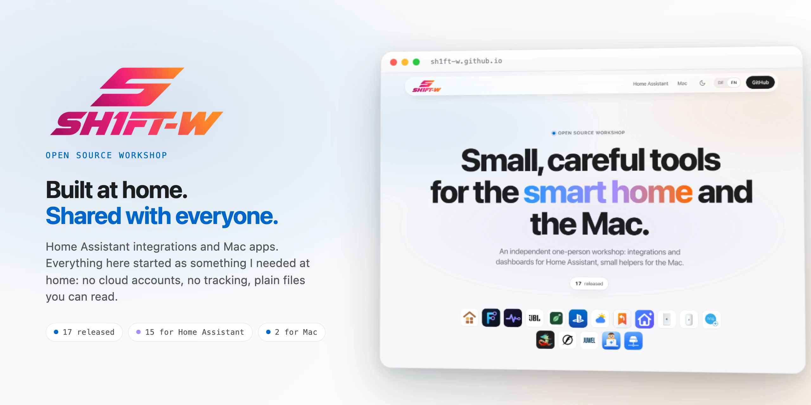

<picture>
  <source media="(prefers-color-scheme: dark)" srcset="docs/images/readme-title-dark.webp" />
  
</picture>

<a href="https://sh1ft-w.github.io"><b>Website</b></a>&emsp;<a href="#home-assistant">Home Assistant</a>&emsp;<a href="#mac">Mac</a>&emsp;<a href="#how-i-work">How I work</a>

 

I build Home Assistant integrations and dashboards, and small apps for the Mac menu bar. Everything here started as something I needed at home.

It all runs locally: no cloud accounts, no tracking, plain files you can read. Every project has its own page on [sh1ft-w.github.io](https://sh1ft-w.github.io).

## Home Assistant

| | Project | What it does |
|:--:|:--|:--|
|  | [**Casora**](https://github.com/SH1FT-W/casora) | A calm, room-by-room dashboard, with a visual studio to shape each room |
|  | [**FLODE**](https://github.com/SH1FT-W/flode) | Automations and scripts as a flow, saved as plain Home Assistant YAML |
|  | [**Pulse**](https://github.com/SH1FT-W/pulse) | Notices when battery sensors go quiet, without polling them |
|  | [**Recall**](https://github.com/SH1FT-W/recall) | Remembers a state and restores it later, unless someone changed it by hand |
|  | [**SF Symbols**](https://github.com/SH1FT-W/sf-symbols) | Apple's SF Symbols as icons everywhere in Home Assistant |
|  | [**Pflanzenmonitor Plus**](https://github.com/SH1FT-W/pflanzenmonitor-plus) | Plant status and limits, a watering forecast from each plant's history, AI-suggested limits |
|  | [**Wetter & Warnungen**](https://github.com/SH1FT-W/wetter-warnungen) | German Weather Service forecast, nearest station and every official warning (DWD, NINA) |
|  | [**JBL Bar**](https://github.com/SH1FT-W/jbl-bar) | JBL soundbars with JBL One, fully local: power, EQ, rear speakers, live Dolby Atmos format |
|  | [**PS5**](https://github.com/SH1FT-W/playstation-5) | Status, wake-up and rest mode for the PlayStation 5, fully local without cloud or MQTT |
|  | [**UniFi Dream Router 7**](https://github.com/SH1FT-W/unifi-dreamrouter7) | The router and every UniFi device behind it: WiFi, firewall, ports, PoE, clients, speed tests |
|  | [**UniFi UNAS**](https://github.com/SH1FT-W/unifi-unas) | Storage, drives, data scrubs and health of a UniFi NAS, locally |
|  | [**Ring Intercom Plus**](https://github.com/SH1FT-W/ring-intercom-plus) | Extra controls next to the official Ring integration: door opener, Ring-to-Open, unlock duration |
|  | [**Chihiros**](https://github.com/SH1FT-W/chihiros) | Chihiros LEDs, Commander and dosing pump, locally over Bluetooth proxies |
|  | [**Fluval**](https://github.com/SH1FT-W/fluval) | Fluval Bluetooth LEDs, locally: Reef and Plant 4.0, the Nanos, Plant PRO and more |
|  | [**HeliaLux**](https://github.com/SH1FT-W/helialux) | The Juwel HeliaLux SmartControl, local and robust |

## Mac

| | Project | What it does |
|:--:|:--|:--|
|  | [**AgentBar**](https://github.com/SH1FT-W/agentbar) | Your Claude Code agents in the menu bar, with a tiny animated office |
|  | [**ShareMount**](https://github.com/SH1FT-W/sharemount) | Network shares that reconnect by themselves, right from the menu bar |

## How I work

- **Local first.** Everything runs inside your Home Assistant or on your Mac. No account, no analytics, no telemetry.
- **Plain files.** Settings and data are readable files on your own machine, part of your own backups.
- **Built in the open.** Every project has a changelog and an issue tracker. Found a bug or have an idea? Open an issue in the project's repository.

 

Built with <a href="https://claude.ai">Claude</a>

